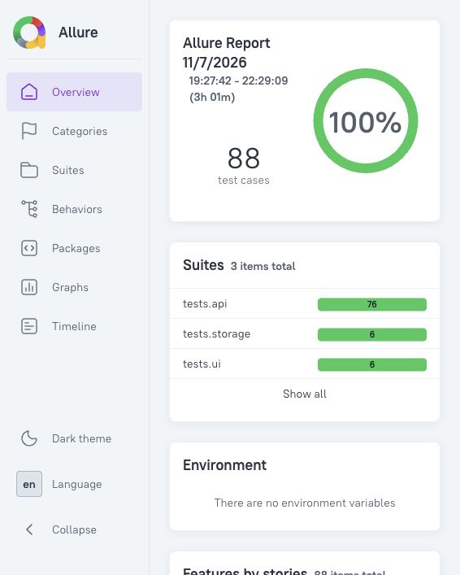

# Allure真实报告快照

日期：2026-11-07（Asia/Shanghai）。**88 passed，0 failed/broken/skipped**，来自公开快照的API76、storage6及新构建APK的真实UI6。不是Jenkins构建。

[机器可读统计](evidence/allure-summary.json)、[API JUnit](evidence/api-junit.xml)、[UI JUnit](evidence/ui-junit.xml)、[Session清理](evidence/ui-session-cleanup.json)均对应实际执行。报告起止跨度包含分开执行的准备时间，不能当成纯用例耗时。旧2026-10-31的88 passed保留为[历史统计](evidence/historical-allure-summary.json)，没有冒充本次结果。

## 生成与浏览
PyTest插件已在requirements中，CLI是独立Java工具。按[官方安装步骤](https://allurereport.org/docs/v2/install-for-nodejs/)配置Java与Node，历史/本次CLI均为2.46.1：

~~~sh
npm install -g allure-commandline@2.46.1
allure --version
# 先执行ci-demo.md的本地runner命令，得到api/ui的原始结果
allure generate artifacts/ci/local-demo-01/api/allure-results artifacts/ci/local-demo-01/ui/allure-results -o artifacts/ci/local-demo-01/html-report
allure open --host 127.0.0.1 artifacts/ci/local-demo-01/html-report
~~~

没有Android时只传api/allure-results，报告只能证明后端。每次使用新目录；不要把旧失败/重试混成新通过率。

本次生成使用api/public-validation-01与ui/public-built-apk-01两次明确来源，来源相对路径和widget摘要在统计JSON中。截图由实际Allure页面截取，未重绘或改数字；画面不含桌面、用户目录、Cookie或登录信息。

完整原始结果/HTML可能带主机名、附件和路径，保留在本机验证目录，公开版只含审查后的截图和精简证据。尚未部署GitHub Pages；从仓库图片即可查看快照，自行运行后可本机浏览完整HTML。
