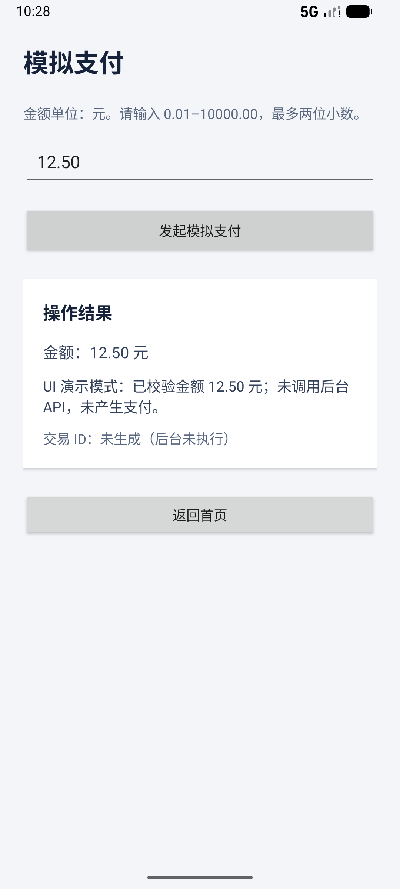

# Android构建与真实UI回归

保持原配置：AGP8.13.2、Kotlin2.3.20、Gradle8.13，compileSDK36.1、target36、min23、Java/Kotlin字节码17。验证使用JDK21。SDK/AVD另行安装，不随仓库提供。

官方依据：[AGP兼容性](https://developer.android.com/build/releases/agp-8-13-0-release-notes)、[Wrapper](https://docs.gradle.org/8.13/userguide/gradle_wrapper.html)、[官方摘要](https://gradle.org/release-checksums/)。构建和Wrapper实际状态见[复现记录](reproduction.md)，已有APK不能证明新构建成功。

## SDK与AVD
安装Android Studio/官方Command-line Tools，按本机位置配置ANDROID_HOME和JAVA_HOME，PATH包含Java、platform-tools、emulator、cmdline-tools；不要复制私人绝对路径。

所需SDK包为platform-tools、emulator、platforms;android-36.1和build-tools;35.0.0（AGP默认）；先用sdkmanager --list确认包名。ARM64 Mac使用匹配的arm64-v8a系统镜像；其他CPU需选择匹配镜像，跨架构未验证。

~~~sh
java -version
adb devices -l
emulator -list-avds
~~~

在Device Manager启动AVD，等adb为device且sys.boot_completed为1。默认emulator-5554，可用ANDROID_UDID覆盖。单设备串行。

## 构建安装
使用官方Wrapper，而非私人Gradle路径：

~~~sh
cd android-app
./gradlew --no-daemon --version
./gradlew --no-daemon assembleDebug
cd ..
adb -s emulator-5554 install -r android-app/app/build/outputs/apk/debug/app-debug.apk
~~~

首次需网络访问Google Maven、MavenCentral和Gradle分发。不要提交local.properties、SDK、缓存或APK。Wrapper JAR是允许的小型构建二进制，须核对来源/摘要并保留第三方许可。Windows脚本未实测。

## Appium与Python
历史验证Node24.14.0、Appium3.2.0、UiAutomator2 8.7.0。官方步骤见[Appium](https://appium.io/docs/en/3.2/quickstart/install/)与[UiAutomator2](https://appium.github.io/appium-uiautomator2-driver/latest/getting-started/)。

~~~sh
.venv/bin/python -m pip install -r requirements-ui.txt
npm install -g appium@3.2.0
export APPIUM_HOME="$PWD/.appium-home"
appium driver install uiautomator2@8.7.0
appium driver doctor uiautomator2
~~~

npm无写权限时使用Node版本管理器或用户prefix，不需要sudo。项目驱动目录为可重建缓存，不公开。

推荐runner创建并停止自己的Appium：

~~~sh
.venv/bin/python scripts/ci_runner.py ui --output artifacts/ci/ui-demo-01
~~~

输出目录须全新。runner不安装APK/启动AVD，缺前置会失败；4723占用则拒绝接管。结束保留设备并关闭自己的Appium；核对session.json、截图/XML、quit.txt和服务端DELETE。

也可终端A启动服务，终端B执行正式测试：

~~~sh
APPIUM_HOME="$PWD/.appium-home" appium --address 127.0.0.1 --port 4723
# 另一终端
.venv/bin/python -m pytest tests/ui -v --junitxml=artifacts/ui/junit.xml
~~~

结束后Ctrl+C停止自己启动的服务。App只是金额展示，没有后台支付。不能通过跳过/放宽断言伪装成功。

截图来自2026-11-07新构建APK的真实test_payment_ui_demo；只有虚构金额与明确的UI演示提示，没有后台交易。
